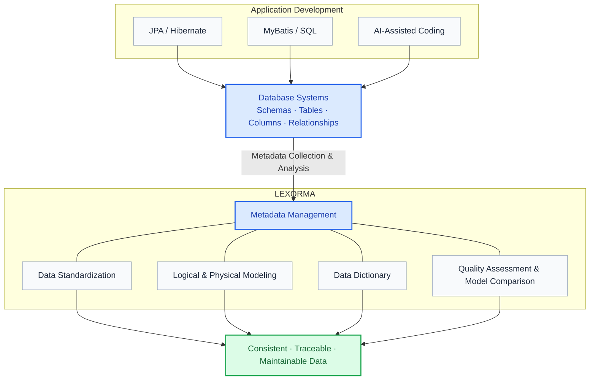

<h1>Lexorma</h1>

<h3>Open Source Data Standardization &amp; Metadata Management Platform</h3>

  <strong>Keeping Data Consistent Across Developers, 
  Technologies, and AI-Driven Development.</strong>

  
  
  

  Data Standards · Metadata Management · Data Modeling · Data Dictionary

  <em>Development technologies may change, but data consistency must endure.</em>

---

## Why Lexorma Exists

Software systems evolve continuously, but their data structures often outlive the developers, frameworks, and technologies that originally created them.

Many enterprise systems have been maintained for years, sometimes decades. During that time, development teams change, new features are introduced, and database schemas are continuously modified.

However, data standards, database documentation, and metadata management practices do not always evolve at the same pace.

Over time, this creates a growing gap between the original design and the actual database structure.

Business definitions become unclear, naming conventions become inconsistent, and understanding existing data increasingly depends on individual developers or historical source code.

Modern development practices introduce additional challenges.

ORM frameworks such as JPA and Hibernate improve application development productivity. However, when database design is driven primarily by application requirements, organization-wide data standards may receive insufficient attention.

More recently, AI-assisted development and vibe coding have accelerated software creation. AI coding tools can generate application code and database schemas rapidly, but they may not have sufficient knowledge of existing data structures, established naming conventions, or business definitions.

> **Faster development should not mean uncontrolled database design.**
>
> Lexorma was created to help organizations preserve data consistency, understand existing database structures, and manage metadata independently of development technologies.

Our goal is to provide an open-source foundation for understanding, standardizing, documenting, and managing data structures independently of development technologies and individual developers.

---

## The Problems We Aim to Solve

<table>
<tr>
<td width="50%" valign="top">

**01 — Legacy Database Complexity**

Long-running systems accumulate undocumented tables, columns, and relationships.

Outdated models make database structures increasingly difficult to understand and maintain.

</td>
<td width="50%" valign="top">

**02 — Loss of Data Knowledge**

Frequent developer turnover causes business definitions and design knowledge to disappear.

Understanding existing data becomes dependent on individual experience.

</td>
</tr>
<tr>
<td valign="top">

**03 — Fragmented Data Design**

Application-centric development can introduce inconsistent naming conventions, data types, and database structures.

Data standards are not always managed independently of application code.

</td>
<td valign="top">

**04 — AI-Driven Schema Inconsistency**

AI coding tools may generate duplicate tables or inconsistent columns without understanding existing metadata.

Rapid code generation can increase long-term structural complexity.

</td>
</tr>
<tr>
<td valign="top">

**05 — Limited Change Visibility**

Database changes are difficult to compare, validate, and trace.

Teams may struggle to understand structural differences and potential impacts.

</td>
<td valign="top">

**06 — High Adoption Barriers**

Traditional metadata management solutions may require complex infrastructure, configuration, or licensing.

Development teams need more accessible alternatives.

</td>
</tr>
</table>

---

## The Challenge

<table>
<tr>
<th align="center">Long-Running Systems</th>
<th align="center">Changing Development Teams</th>
<th align="center">AI-Assisted Development</th>
</tr>
<tr>
<td align="center">Accumulating schema changes</td>
<td align="center">Loss of business knowledge</td>
<td align="center">Incomplete metadata context</td>
</tr>
</table>

↓

<table>
<tr><th align="center">Fragmented Data Definitions</th></tr>
<tr><td align="center">Inconsistent naming · Missing documentation · Duplicated concepts</td></tr>
</table>

↓

<table>
<tr><th align="center">Increasing Database Complexity</th></tr>
<tr><td align="center">Model drift · Unclear relationships · Limited change visibility</td></tr>
</table>

↓

<strong>Higher Maintenance Costs &amp; Reduced Data Consistency</strong>

---

## How Lexorma Helps

Lexorma provides a unified environment for managing database structures, data standards, and business metadata.

Rather than depending on a specific programming language or application framework, Lexorma focuses on the database structures and definitions that applications share.

### Database-Centric Approach

Lexorma manages data standards and metadata independently of application development technologies.

Lexorma does not require direct integration with ORM frameworks or application source code.

Instead, it collects and manages database metadata independently of application implementation technologies.

### Our Approach

| | Approach | Purpose |
|:---:|---|---|
| **01** | **Discover** | Understand existing database structures through metadata collection and schema analysis. |
| **02** | **Standardize** | Establish consistent data definitions, naming conventions, and reusable standards. |
| **03** | **Model & Validate** | Manage logical and physical models and evaluate consistency with established standards. |
| **04** | **Track & Analyze** | Improve visibility into metadata differences, model changes, and related structures. |
| **05** | **Assist** | Support metadata-grounded AI analysis and recommendations when enabled. |

---

## Core Capabilities

| Capability | Description |
|---|---|
| **Data Standardization** | Manage standard words, terms, domains, and naming conventions. |
| **Metadata Management** | Organize schemas, tables, columns, and associated metadata. |
| **Data Dictionary** | Connect technical metadata with meaningful business definitions. |
| **Logical Data Modeling** | Define business entities, attributes, identifiers, and relationships. |
| **Physical Data Modeling** | Manage database tables, columns, constraints, and relationships. |
| **Interactive ERD** | Visualize and explore logical and physical data structures. |
| **Model Mapping** | Connect logical and physical models and evaluate consistency. |
| **Metadata Synchronization** | Collect and compare metadata from existing database environments. |
| **Data Quality Assessment** | Identify inconsistencies between standards and managed models. |
| **Change Analysis** | Support model comparison, change visibility, and future impact analysis. |

> Some advanced capabilities remain under development. Feature availability may vary by release.

---

## AI-Assisted Development

<h3>Faster Development. Consistent Data Design.</h3>

<em>AI should accelerate development without compromising long-term data consistency.</em>

AI-assisted development is changing how software is built.

Developers can generate application code, SQL statements, and database schemas faster than ever before.

However, AI coding tools do not always have complete knowledge of existing database architectures.

Without reliable metadata context, AI-generated database structures may introduce inconsistent naming, duplicated business concepts, or unnecessary complexity.

Lexorma aims to provide a structured metadata foundation for more consistent AI-assisted database design.

### Metadata-Grounded AI

<table>
<tr>
<th align="center">Existing Database Metadata</th>
<th align="center">Established Data Standards</th>
</tr>
<tr>
<td align="center">Tables · Columns · Relationships</td>
<td align="center">Words · Terms · Domains</td>
</tr>
</table>

↓

<table>
<tr><th align="center">Business Definitions &amp; Data Dictionary</th></tr>
<tr><td align="center">Shared understanding of data meaning</td></tr>
</table>

↓

<table>
<tr><th align="center">AI-Assisted Metadata Analysis</th></tr>
<tr><td align="center">Standard-aware recommendations · Schema evaluation</td></tr>
</table>

↓

<table>
<tr><th align="center">Human Review &amp; Approval</th></tr>
<tr><td align="center">Controlled decisions without autonomous database modification</td></tr>
</table>

### Development Direction

Our planned and evolving AI capabilities include:

- Automated business description and data dictionary suggestions.
- Metadata quality analysis.
- Detection of potentially duplicated data concepts.
- Relationship inference between database structures.
- Standard-aware table and column recommendations.
- Intelligent schema documentation.
- Metadata-assisted evaluation of proposed database changes.
- Local and private LLM integration.

### AI Is Optional

**Lexorma's core functionality does not depend on AI.**

Data standardization, modeling, and metadata management must remain usable without an external AI service, a local LLM, or a separate MCP server.

AI-generated recommendations remain subject to human review and approval.

---

## What You Gain With Lexorma

<table>
<tr>
<td width="33%" align="center" valign="top">

<h3>Consistency</h3>

Maintain shared data standards across developers, applications, and development technologies.

</td>
<td width="33%" align="center" valign="top">

<h3>Traceability</h3>

Improve visibility into database structures, definitions, and changes.

</td>
<td width="33%" align="center" valign="top">

<h3>Maintainability</h3>

Preserve data knowledge and simplify long-term system maintenance.

</td>
</tr>
</table>

### Value Across the Development Lifecycle

| For | Value |
|---|---|
| **Developers** | Understand existing data structures and follow established standards. |
| **Database Designers** | Manage logical and physical models and evaluate consistency. |
| **Maintenance Teams** | Preserve business knowledge and reduce uncertainty in legacy systems. |
| **AI-Assisted Developers** | Use structured metadata as a foundation for consistent database design. |
| **Organizations** | Maintain data definitions as long-term assets rather than individual knowledge. |

---

## Our Design Principles

| Principle | Commitment |
|---|---|
| **Database-Centric** | Manage metadata independently of application frameworks. |
| **Consistency** | Encourage shared standards and naming conventions. |
| **Knowledge Preservation** | Treat metadata and business definitions as long-term assets. |
| **Transparency** | Make data structures and changes understandable. |
| **Human Control** | Keep critical data design decisions under human authority. |
| **Minimal Complexity** | Avoid unnecessary infrastructure and configuration. |
| **Safe Integration** | Analyze source database metadata without requiring structural modifications. |
| **Open & Extensible** | Provide an open-source foundation for evolving data management needs. |

---

## Technology Stack

  
  
  

  
  

  
  

Lexorma follows a self-hosted architecture emphasizing simple deployment, controlled dependencies, and support for private development environments.

The platform is designed around a single-server deployment model, with optional integrations enabled only when needed.

---

## Our Vision

Software development will continue to evolve.

Programming languages will change. Frameworks will be replaced. Development teams will rotate. AI will increasingly participate in designing and generating software.

But the need for consistent, understandable, and trustworthy data structures will remain.

Lexorma aims to provide a lasting foundation for managing those structures across generations of software development.

We want to help teams build systems where data definitions remain understandable, database models remain consistent, and technical knowledge survives beyond individual developers or development tools.

---

<h3>Lexorma</h3>

<strong>Bringing Structure, Consistency, and Continuity to Data.</strong>

<em>Because data should remain consistent, even when everything around it changes.</em>

